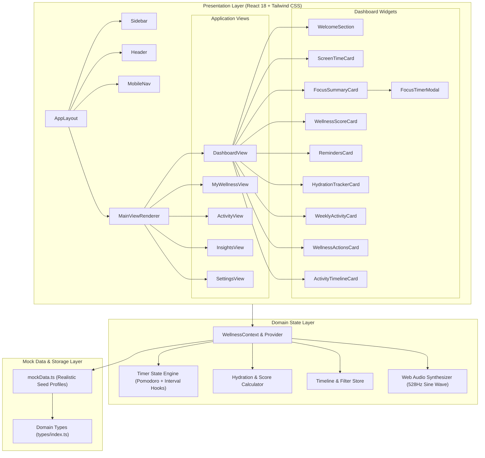

# Mindora — Initial Architecture Specification

**Version:** 1.0.0 (Sprint 1: Foundation & Dashboard)  
**Status:** Approved  
**Author:** Lead Full-Stack Engineer  

---

## 1. System Vision & Architecture Principles

Mindora is engineered as an AI-powered personalized mental wellness companion tailored for high-focus technical and creative knowledge workers. The architecture adheres to four core pillars:

1. **Calm Technology Philosophy**: The interface is intentionally free of abrasive alerts, flashing animations, and cognitive clutter. Subtle earthen palettes, muted sage greens, and warm sand neutrals foster sustained composure.
2. **Strict Type Safety**: End-to-end domain modeling in TypeScript eliminates runtime type mismatches and establishes explicit contracts for all wellness entities.
3. **Atomic & Modular Component Architecture**: Reusable UI primitives (`Card`, `Badge`, `Button`, `ProgressBar`, `CircularProgress`, `Modal`) decouple visual representation from domain logic.
4. **Predictable Unidirectional State Flow**: Centralized state management via React Context (`WellnessContext`) enables consistent real-time updates across multiple widgets without prop drilling or external state overhead.

---

## 2. High-Level System Architecture



---

## 3. Component Hierarchy

### 3.1 Common UI Primitives (`src/components/common/`)
- **`Card`**: Standardized elevation container with gentle sand borders (`border-sand-200/90`), white background, and customizable padding variants.
- **`Badge`**: Pill indicators featuring semantic color variants (`sage`, `sand`, `clay`, `sky`, `amber`, `stone`) and optional micro-icons.
- **`Button`**: Accessible interactive element supporting primary, soft-sage, secondary, outline, ghost, and danger styling.
- **`Modal`**: Backdrop-blurred accessible dialog with keyboard `Escape` dismissal, focus capture, and scroll locking.
- **`ProgressBar`**: Smooth horizontal progression indicator with customizable track and fill tokens.
- **`CircularProgress`**: SVG-based dynamic radial progress ring with `stroke-dashoffset` interpolation for wellness scores and timers.

### 3.2 Layout System (`src/components/layout/`)
- **`Sidebar`**: Persistent desktop navigation drawer featuring Mindora brand insignia, primary navigation items with badge counters, real-time focus companion mini-pod, quick hydration meter, and user profile miniature.
- **`Header`**: Sticky header housing breadcrumb titles, today’s date pill, quick-tap hydration logger (`+250ml`), focus timer trigger, and pending notification badge.
- **`MobileNav`**: Dual-mode mobile system featuring a bottom tab bar for thumb-driven navigation and an off-canvas slide-over drawer for deep links.
- **`AppLayout`**: Structural wrapper orchestrating the responsive grid and hosting the global `FocusTimerModal`.

### 3.3 Dashboard Architecture (`src/components/dashboard/`)
1. **`WelcomeSection`**: Time-of-day contextual greeting ("Good morning / afternoon / evening"), current workday summary, and interactive 5-point state-of-mind logger.
2. **`ScreenTimeCard`**: Total screen time vs limit budget, continuous strain threshold alerts, and segmented category bar chart.
3. **`FocusSummaryCard`**: Completed vs targeted focus blocks, current daily streak, and timer preview widget.
4. **`FocusTimerModal`**: Dedicated focus session engine with 25m Focus, 5m Short Break, and 15m Long Break presets, circular countdown, intention input, and Web Audio harmonic chime.
5. **`WellnessScoreCard`**: Aggregate daily score (0–100) with dimension breakdown (Physical, Mental Focus, Rhythm, Rest Recovery) and AI observation summaries.
6. **`RemindersCard`**: Upcoming/due reminders with filterable tabs (Due vs Done), 15-minute snooze controls, and complete actions.
7. **`HydrationTrackerCard`**: Visual glass indicators (8x 250ml units), addition/subtraction buttons, and real-time timeline logging.
8. **`WeeklyActivityCard`**: 7-day bar chart with metric selector (Focus Hours, Screen Hours, Wellness Score) and interactive tooltip inspection.
9. **`WellnessActionsCard`**: Actionable protocols (4-7-8 breathing, neck release, eye depth shift) with completion toggle feedback.
10. **`ActivityTimelineCard`**: Chronological event stream with category pills (Focus, Breaks, Movement, Hydration, Mindfulness) and custom activity entry drawer.

---

## 4. State Management & Data Flow

### 4.1 State Distribution (`WellnessContext.tsx`)
The application encapsulates state in `WellnessContext`, exposing reactive accessors and dispatchers:

```typescript
interface WellnessContextType {
  activeTab: NavigationTab;
  setActiveTab: (tab: NavigationTab) => void;
  user: UserProfile;
  updateUserGoals: (goals: Partial<UserProfile['dailyGoals']>) => void;
  screenTime: ScreenTimeData;
  wellnessScore: WellnessScoreData;
  recalculateWellnessScore: () => void;
  focusSummary: FocusSessionSummary;
  focusTimer: FocusTimerState;
  isTimerModalOpen: boolean;
  setIsTimerModalOpen: (open: boolean) => void;
  setTimerMode: (mode: FocusTimerMode) => void;
  startTimer: () => void;
  pauseTimer: () => void;
  resetTimer: () => void;
  skipTimer: () => void;
  toggleSound: () => void;
  setActiveTaskName: (name: string) => void;
  hydration: HydrationLog;
  logGlassOfWater: () => void;
  removeGlassOfWater: () => void;
  reminders: ReminderItem[];
  completeReminder: (id: string) => void;
  snoozeReminder: (id: string) => void;
  dismissReminder: (id: string) => void;
  timeline: ActivityTimelineItem[];
  timelineCategoryFilter: 'all' | ActivityCategory;
  setTimelineCategoryFilter: (filter: 'all' | ActivityCategory) => void;
  addTimelineItem: (item: Omit<ActivityTimelineItem, 'id' | 'timestamp' | 'timeDisplay'>) => void;
  weeklyActivity: DayActivityData[];
  weeklyMetric: 'screenTime' | 'focus' | 'wellness';
  setWeeklyMetric: (metric: 'screenTime' | 'focus' | 'wellness') => void;
  recommendedActions: RecommendedWellnessAction[];
  toggleActionCompletion: (id: string) => void;
  moodEntries: MoodEntry[];
  logMood: (level: 1 | 2 | 3 | 4 | 5, label: string, note?: string) => void;
  insights: WellnessInsightItem[];
}
```

### 4.2 Web Audio Synthesis
Rather than bundling binary `.mp3` or `.wav` sound files, Mindora synthesizes a soothing 528Hz Tibetan singing bowl tone using the browser’s native `AudioContext`:
- Pure sine oscillator (`osc.type = 'sine'`)
- Soft attack (50ms exponential ramp up to 0.2 gain)
- Natural acoustic exponential decay (1200ms ring-down)
- Complete offline capability and zero network overhead.

---

## 5. Visual Identity & Color System

The color tokens defined in `tailwind.config.js` represent a grounding, restorative environment:

| Token Name | Hex Code | Purpose |
|---|---|---|
| `bg-base` | `#FAF9F5` | Calming page background, softer than harsh `#FFFFFF` |
| `sage-700` | `#305334` | Primary brand accent and active interactive states |
| `sage-100` | `#E6EFE6` | Soft pill backgrounds and restful highlights |
| `sand-200` | `#ECE8DF` | Subtle borders, dividers, and card containers |
| `calm-water` | `#3B82A6` | Hydration metrics and fluid recovery indicators |
| `calm-ochre` | `#C97D29` | Break reminders and gentle attention cues |
| `clay-500` | `#C36E4F` | Movement and physical ergonomics notifications |

---

## 6. Sprint 1 Boundaries & Future Extensibility

To maintain a disciplined sprint boundary, Sprint 1 focuses exclusively on front-end architecture, interaction design, and mock state synchronization:

| Capability | Sprint 1 Status | Future Sprint Target |
|---|---|---|
| Dashboard & Design System | ✅ Completed | Continuous refinement |
| Working Focus Session Timer | ✅ Completed | Integration with OS notifications |
| Interactive Hydration & Habits | ✅ Completed | Bluetooth water bottle / smart sync |
| Mock Work-Pattern Data | ✅ Completed | Local SQLite / IndexDB persistence |
| OS Activity Tracking Daemon | ⏹️ Out of scope | Sprint 2 (Work Pattern Engine) |
| On-Device AI / LLM Integration | ⏹️ Out of scope | Sprint 3 (Adaptive Recommendations) |
| Backend API & Authentication | ⏹️ Out of scope | Sprint 4 (Multi-device Sync) |
