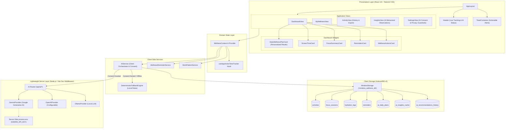
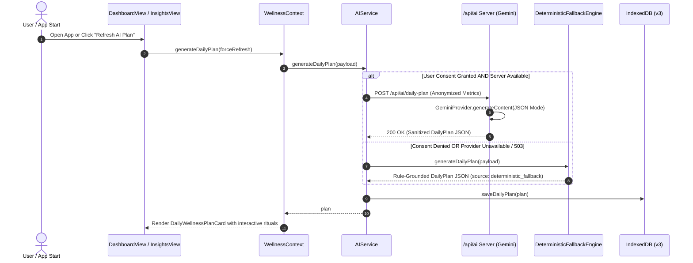

# Mindora — System Architecture Specification

**Version:** 4.0.0 (Sprint 4: AI-Powered Wellness Personalization & Adaptive Daily Planning)  
**Status:** Approved  
**Author:** Lead Full-Stack Engineer  

---

## 1. System Vision & Architecture Principles

Mindora is an AI-powered personalized mental wellness companion tailored for high-focus technical and creative knowledge workers. The architecture adheres to seven core pillars:

1. **Calm Technology Philosophy**: Free of abrasive alerts, flashing animations, and cognitive clutter. Interventions use gentle earthen aesthetics, harmonic 528Hz chimes, and respectful pacing.
2. **Local Data Sovereignty**: All activities, focus sessions, hydration logs, adaptive reminders, and notification history are stored locally on the user’s device via **IndexedDB** (`mindora_wellness_db` v3).
3. **Server-Side API Key Isolation**: External LLM credentials (e.g. `GEMINI_API_KEY`) reside strictly on the server and are **never** exposed to client browser bundles.
4. **Deterministic Graceful Degradation**: When AI providers are offline, unconfigured, or when users decline AI consent, Mindora transparently falls back to local rule-based intelligence without degrading functionality.
5. **Informed Consent & Data Minimization**: Transmits only anonymized, aggregate metrics (focus durations, session counts, hydration progress, general mood numbers). Never transmits keystrokes, screen recordings, private text notes, or file names.
6. **Non-Medical Boundary Guarantees**: Interventions focus exclusively on cognitive pacing, restorative micro-resets, and physical ergonomics. Mindora strictly avoids medical diagnoses or clinical advice.
7. **Decoupled Telemetry & Intelligence Engines**: Telemetry (`WorkPatternService`), Reminders (`WellnessReminderService`), and Personalization (`AIService`) operate completely independently of the presentation layer.

---

## 2. High-Level System Architecture



---

## 3. Server-Side AI Architecture & Security Invariants

### 3.1 Security Isolation Invariant
- **No Client Secrets**: Neither `GEMINI_API_KEY` nor other provider credentials exist in client-side code or Vite `import.meta.env` client bundles.
- **Lightweight Backend Proxy**: Handled through `server/aiRouter.mjs` and `server/aiService.mjs`.
  - In development (`npm run dev`), intercepted via a custom Vite dev server middleware plugin (`mindoraAiServerPlugin`).
  - In standalone/production mode (`npm run server`), served by Node's native HTTP server (`server/index.mjs`) on `PORT` (default 3001).

### 3.2 Medical Safety System Instructions
All LLM prompts inject a mandatory safety preamble:
> "Under no circumstances provide clinical diagnoses, psychiatric assessments, or medical treatment advice. Focus purely on digital ergonomics, cognitive pacing, and restorative pauses."

### 3.3 Data Minimization Schema
The payload sent to `/api/ai/*` contains strictly anonymized numeric and category metrics:
```json
{
  "userGoals": { "maxScreenTimeMinutes": 360, "targetFocusMinutes": 150, "hydrationGlasses": 8, "breaksCount": 6 },
  "todayMetrics": {
    "focusMinutes": 120, "focusSessionCount": 3, "averageSessionMinutes": 40,
    "screenTimeMinutes": 280, "inAppActiveMinutes": 45, "continuousStrainMinutes": 55,
    "hydrationGlasses": 4, "breakCount": 3, "wellnessScore": 84
  },
  "recentMoodSummary": { "latestMoodLevel": 4, "latestMoodLabel": "Energized", "averageMoodScore": 3.8 }
}
```
*Zero raw keystrokes, zero screenshots, zero private notes, zero file paths.*

---

## 4. Personalized Daily Wellness Plan & Insights Engine



---

## 5. Storage Schema: IndexedDB v3

The database (`mindora_wellness_db`) is upgraded to **Version 3** with 10 dedicated Object Stores:

| Store Name | KeyPath | Indexes | Purpose |
| :--- | :--- | :--- | :--- |
| `activities` | `id` | `by_dateKey`, `by_category`, `by_timestamp` | Chronological activity stream |
| `focus_sessions` | `id` | `by_dateKey`, `by_completedAt` | Recorded Pomodoro focus intervals |
| `hydration_logs` | `id` | `by_dateKey` | Hydration intake events |
| `app_usage` | `dateKey` | — | Active in-app usage heartbeat |
| `mood_entries` | `id` | `by_dateKey` | Energy & subjective state entries |
| `user_settings` | `key` | — | User goals, notification settings, AI consent |
| `reminders` | `id` | `by_category`, `by_status`, `by_dueAt` | Adaptive reminders lifecycle state |
| `notification_history`| `id` | `by_timestamp`, `by_category` | Audited delivery history |
| **`ai_daily_plans`** *(v3)* | `dateKey` | `by_generatedAt` | Persisted personalized daily plans |
| **`ai_insights_cache`** *(v3)*| `id` | `by_generatedAt` | Latest cognitive rhythm & pattern cache |
| **`ai_recommendations_history`** *(v3)*| `id` | `by_deliveredAt`, `by_hash` | Delivered hashes to prevent duplicate suggestions |
