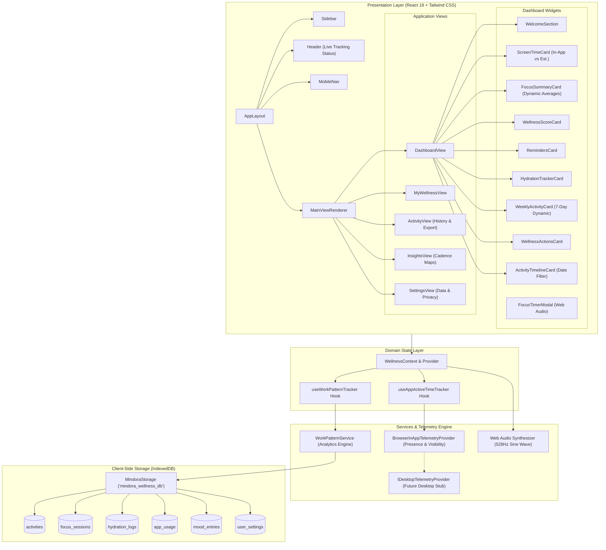

# Mindora — System Architecture Specification

**Version:** 2.0.0 (Sprint 2: Work-Pattern Tracking & Persistent Telemetry)  
**Status:** Approved  
**Author:** Lead Full-Stack Engineer  

---

## 1. System Vision & Architecture Principles

Mindora is engineered as an AI-powered personalized mental wellness companion tailored for high-focus technical and creative knowledge workers. The architecture adheres to five core pillars:

1. **Calm Technology Philosophy**: Free of abrasive alerts, flashing animations, and cognitive clutter. Subtle earthen palettes, muted sage greens, and warm sand neutrals foster sustained composure.
2. **Local Data Sovereignty**: All activities, focus sessions, hydration logs, and preferences are stored exclusively on the user’s device via **IndexedDB** (`mindora_wellness_db`). Zero personal telemetry or activity events are sent to external cloud servers.
3. **Strict Type Safety**: End-to-end domain modeling in TypeScript eliminates runtime type mismatches and establishes explicit contracts for all wellness and tracking entities.
4. **Decoupled Telemetry Pipeline**: Tracking engines (`BrowserInAppTelemetryProvider`, `WorkPatternService`) operate independently of the React presentation layer, making the system pluggable for native desktop daemons.
5. **Privacy by Design**: Telemetry strictly measures temporal presence and session boundaries. It **never** captures keystroke values, screen pixels, clipboard data, or file system contents.

---

## 2. High-Level System Architecture



---

## 3. Storage Architecture Decision: IndexedDB

### Why IndexedDB?
Sprint 2 introduced persistent tracking to replace mock data. We evaluated three client-side browser storage mechanisms:

| Storage Solution | Storage Limit | Async / Non-blocking | Indexing & Queries | Structured Schemas | Decision |
|---|---|---|---|---|---|
| `localStorage` | ~5 MB | No (blocks main thread) | No (key string only) | No | Rejected for activity streams |
| `IndexedDB` | > 500 MB (quota based) | **Yes (fully async)** | **Yes (dateKey, category)** | **Yes (Object Stores)** | **Adopted (Zero Dependencies)** |
| SQLite (Wasm) | High | Async | Yes | Yes | Deferred (added 2MB+ Wasm overhead) |

### Object Stores Specification (`mindora_wellness_db` v1)
1. **`activities`**: Primary event log.
   - Key: `id` (e.g., `act_1732274400_abc`)
   - Indices: `by_dateKey` (`YYYY-MM-DD`), `by_category`, `by_timestamp`
2. **`focus_sessions`**: Completed and active Pomodoro / deep flow intervals.
   - Key: `id` (e.g., `sess_1732274400_xyz`)
   - Indices: `by_dateKey`, `by_completedAt`
3. **`hydration_logs`**: Volume records of water intake.
   - Key: `id`
   - Indices: `by_dateKey`
4. **`app_usage`**: In-app temporal active presence and continuous strain stretches.
   - Key: `dateKey` (`YYYY-MM-DD`)
5. **`mood_entries`**: Subjective emotional & energy state check-ins.
   - Key: `id`
   - Indices: `by_dateKey`
6. **`user_settings`**: Daily goals, reminders cadence, and sensory audio preferences.
   - Key: `key`

---

## 4. Telemetry & Tracking Architecture

### 4.1 Telemetry Interfaces (`telemetryInterfaces.ts`)
To maintain zero coupling between tracking mechanisms and the user interface, telemetry adheres to a provider contract:

```typescript
export interface ITelemetryProvider {
  initialize(): void;
  dispose(): void;
  onPresenceChange(callback: (isActive: boolean) => void): () => void;
  onVisibilityChange(callback: (isVisible: boolean) => void): () => void;
  isCurrentlyActive(): boolean;
  getMetadata(): TelemetryMetadata;
}
```

### 4.2 BrowserInAppTelemetryProvider
- **Tab Visibility**: Subscribes to `document.visibilitychange`. If the user minimizes the browser or navigates to another tab, presence transitions to inactive, stopping in-app screen time accumulation.
- **Presence & Idle Detection**: Listens to passive window events (`pointermove`, `pointerdown`, `scroll`, `wheel`). Resets an idle timeout (60 seconds threshold).
- **Privacy Enforcement**: **No keyboard character capture** (`e.key` is ignored; only interaction timestamps are noted). Zero audio, camera, or screen scraping.

### 4.3 WorkPatternService
Encapsulates analytics algorithms:
- **Daily Focus Duration**: Sums completed sessions for `dateKey`.
- **Average Focus Length**: Computes `totalFocusMinutes / completedSessions`.
- **Focus-to-Break Cadence**: Formats ratio of deep work minutes to restorative pause minutes.
- **Continuous Stretch Strain Detection**: Tracks continuous activity without a >= 5 min break; flags strain warning if continuous duration $\ge 50$ minutes.
- **7-Day Dynamic Activity Trend**: Aggregates the last 7 calendar days to drive the weekly dashboard bar visualization.

---

## 5. Screen Time Distinction & Limitations

### Browser Security Boundary
Inside standard web browsers, security sandboxing strictly prevents web applications from inspecting other native operating system processes (e.g. knowing whether the user has switched to VS Code, Figma, Slack, or Xcode).

### Mindora's Dual-Metric Approach
To ensure complete transparency and user trust:
1. **Verified In-App Active Time**: The exact duration the user spent interacting with Mindora, logged down to the second via `BrowserInAppTelemetryProvider`.
2. **Estimated Workday Screen Time**: A modeled metric combining verified deep work blocks, recorded micro-breaks, in-app active duration, and the user's daily work baseline.

*Sprint 3 & Sprint 4 roadmap will introduce an optional native desktop daemon stub (`IDesktopTelemetryProvider`) to bridge system-wide application tracking when explicitly authorized by the user.*

---

## 6. Privacy & User Control

- **Transparent Status Indicator**: Sticky header displays a live tracking pill (`● Tracking: In-App Active` or `Tracking: Idle`).
- **Complete Storage Erase**: Users can clear all locally stored IndexedDB data at any time via Settings or the Activity view.
- **Data Portability**: Users can export their complete telemetry and session archive as a structured JSON file at any time.
