# Mindora — System Architecture Specification

**Version:** 5.0.0 (Sprint 5: Conversational AI Wellness Companion & Guided Resets)  
**Status:** Approved  
**Author:** Lead Full-Stack Engineer  

---

## 1. System Vision & Architecture Principles

Mindora is an AI-powered personalized mental wellness companion tailored for high-focus technical and creative knowledge workers. The architecture adheres to eight core pillars:

1. **Calm Technology Philosophy**: Free of abrasive alerts, flashing animations, and cognitive clutter. Interventions use gentle earthen aesthetics, harmonic 528Hz chimes, and respectful pacing.
2. **Local Data Sovereignty**: All activities, focus sessions, hydration logs, adaptive reminders, and complete conversation histories are stored locally on the user’s device via **IndexedDB** (`mindora_wellness_db` v4).
3. **Conversational Support & Guided Experiences**: Conversational companion capable of answering questions about work patterns and leading interactive in-chat guided resets (4-7-8 breathing, 20-20-20 eye relaxation, neck/shoulder stretches, focus prep).
4. **Server-Side API Key Isolation**: External LLM credentials (e.g. `GEMINI_API_KEY`) reside strictly on the server and are **never** exposed in client browser bundles.
5. **Deterministic Graceful Degradation**: When AI providers are offline, unconfigured, or when users decline AI consent, Mindora transparently falls back to local rule-based intelligence without degrading functionality.
6. **Informed Consent & Data Minimization**: Transmits only anonymized, aggregate metrics (focus durations, session counts, hydration progress, general mood numbers). Never transmits keystrokes, screen recordings, private text notes, or file names.
7. **Strict Crisis & Non-Medical Safeguards**: Mindora identifies crisis-related language instantly and provides 24/7 emergency hotlines (988, 111, 741741). It positions itself strictly as a digital ergonomics coach and never diagnoses psychiatric or physiological conditions.
8. **Decoupled Telemetry & Intelligence Engines**: Telemetry (`WorkPatternService`), Reminders (`WellnessReminderService`), Personalization (`AIService`), and Conversations (`ConversationService`) operate completely independently of the presentation layer.

---

## 2. High-Level System Architecture

```mermaid
flowchart TD
    subgraph Client_Presentation ["Presentation Layer (React 18 + Tailwind CSS)"]
        AL["AppLayout"]
        HD["Header (Live Tracking & AI Status)"]
        TC["ToastContainer (Actionable Alerts)"]
        
        subgraph Views ["Application Views"]
            DV["DashboardView"]
            WV["MyWellnessView"]
            AV["ActivityView (History & Export)"]
            IV["InsightsView (AI Behavioral Observations)"]
            CV["CompanionView (Conversational AI Chat)"]
            SV["SettingsView (AI Consent & Privacy Guardrails)"]
        end
        
        subgraph Widgets ["Dashboard & Companion Widgets"]
            DWP["DailyWellnessPlanCard (Personalized Rituals)"]
            GEC["GuidedExperienceCard (Interactive Reset Timers)"]
            ST["ScreenTimeCard"]
            FS["FocusSummaryCard"]
            RC["RemindersCard"]
        end
    end

    subgraph State_Layer ["Domain State Layer"]
        WC["WellnessContext & Provider"]
        UAT["useAppActiveTimeTracker Hook"]
    end

    subgraph Client_Services ["Client-Side Services"]
        CS["ConversationService (Chat & Crisis Guardrails)"]
        AIS["AIService (Client Orchestrator & Consent)"]
        DFE["DeterministicFallbackEngine (Local Rules)"]
        WRS["WellnessReminderService"]
        WPS["WorkPatternService"]
    end

    subgraph Storage_Layer ["Client Storage (IndexedDB v4)"]
        IDB["MindoraStorage ('mindora_wellness_db')"]
        S1[("activities")]
        S2[("focus_sessions")]
        S3[("hydration_logs")]
        S4[("reminders")]
        S5[("ai_daily_plans")]
        S6[("ai_insights_cache")]
        S7[("ai_recommendations_history")]
        S8[("conversations")]
        S9[("conversation_messages")]
    end

    subgraph Server_Layer ["Lightweight Server Layer (Node.js / Vite Dev Middleware)"]
        AIR["AI Router (/api/ai/*)"]
        GMP["GeminiProvider (Google Generative AI)"]
        OAP["OpenAIProvider (Configurable)"]
        OLP["OllamaProvider (Local LLM)"]
        ENV["Server-Side process.env (GEMINI_API_KEY)"]
    end

    AL --> HD & TC & Views
    DV --> DWP & ST & FS & RC
    CV --> GEC
    Views --> WC
    WC --> CS & AIS & WRS & WPS & UAT
    CS --> |Consent Granted| AIR
    CS --> |Consent Denied / Offline| DFE
    AIR --> GMP & OAP & OLP
    GMP -.-> ENV
    CS --> IDB
    IDB --> S1 & S2 & S3 & S4 & S5 & S6 & S7 & S8 & S9
```



---

## 3. Conversational Architecture & Crisis Safeguards

### 3.1 Crisis Safeguard Invariant
Client-side regex evaluation executes on every outgoing user message prior to network dispatch:
```typescript
const CRISIS_PATTERNS = [
  /\b(kill|end)\s+(my\s*self|my\s*life)\b/i,
  /\bsuicid(e|al)\b/i,
  /\bwant\s+to\s+die\b/i,
  /\bself[-\s]?harm\b/i,
  /\bhurt\s+myself\b/i,
];
```
If a crisis pattern matches:
- The system bypasses external LLM and local generators.
- An immediate compassionate response is delivered listing:
  - **US/Canada**: Call or text **988** (24/7 Lifeline)
  - **UK**: Call **111** or **116 123**
  - **Crisis Text Line**: Text **HOME** to **741741**
  - **International**: `findahelpline.com`
- The message is tagged with `isCrisisHelp: true` and rendered inside a highlighted support alert container.

### 3.2 Guided Experience Pipeline
When a user requests stress relief, eye strain relief, or ergonomic guidance:
1. The companion crafts a structured `guidedExperience` payload containing step durations and instructions.
2. The UI renders an interactive [`GuidedExperienceCard`](file:///home/nataraj/Downloads/Projects/mindora/src/components/companion/GuidedExperienceCard.tsx) inline with a countdown player.
3. Upon completion, the ritual is automatically committed to the persistent activity timeline via `WorkPatternService`.

---

## 4. Storage Schema: IndexedDB v4

The database (`mindora_wellness_db`) is upgraded to **Version 4** with 12 Object Stores:

| Store Name | KeyPath | Indexes | Purpose |
| :--- | :--- | :--- | :--- |
| `activities` | `id` | `by_dateKey`, `by_category`, `by_timestamp` | Chronological activity stream |
| `focus_sessions` | `id` | `by_dateKey`, `by_completedAt` | Recorded Pomodoro focus intervals |
| `hydration_logs` | `id` | `by_dateKey` | Hydration intake events |
| `app_usage` | `dateKey` | — | Active in-app usage heartbeat |
| `mood_entries` | `id` | `by_dateKey` | Energy & subjective state entries |
| `user_settings` | `key` | — | User goals, notification settings, AI consent |
| `reminders` | `id` | `by_category`, `by_status`, `by_dueAt` | Adaptive reminders lifecycle state |
| `notification_history`| `id` | `by_timestamp`, `by_category` | Audited delivery history |
| `ai_daily_plans` | `dateKey` | `by_generatedAt` | Persisted personalized daily plans |
| `ai_insights_cache` | `id` | `by_generatedAt` | Cognitive rhythm & pattern cache |
| `ai_recommendations_history` | `id` | `by_deliveredAt`, `by_hash` | Delivered hashes to prevent duplicate suggestions |
| **`conversations`** *(v4)* | `id` | `by_updatedAt`, `by_createdAt` | Chat sessions with preview & timestamps |
| **`conversation_messages`** *(v4)* | `id` | `by_conversationId`, `by_timestamp` | Chat message records with guided experiences |
