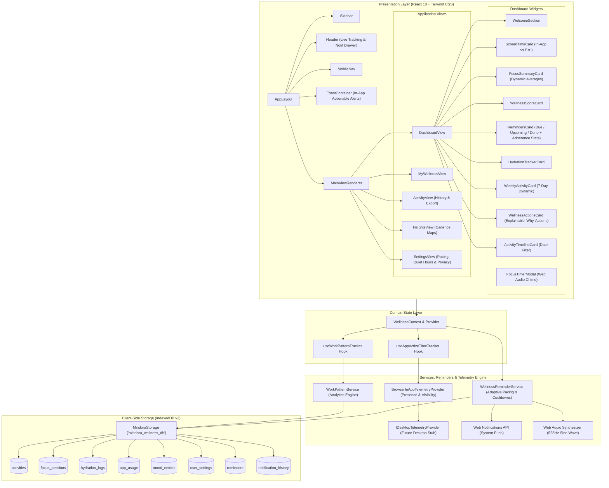

# Mindora — System Architecture Specification

**Version:** 3.0.0 (Sprint 3: Adaptive Wellness Reminder Engine & Intelligent Interventions)  
**Status:** Approved  
**Author:** Lead Full-Stack Engineer  

---

## 1. System Vision & Architecture Principles

Mindora is engineered as an AI-powered personalized mental wellness companion tailored for high-focus technical and creative knowledge workers. The architecture adheres to six core pillars:

1. **Calm Technology Philosophy**: Free of abrasive alerts, flashing animations, and cognitive clutter. Interventions use gentle earthen aesthetics, harmonic 528Hz chimes, and respectful pacing.
2. **Local Data Sovereignty**: All activities, focus sessions, hydration logs, adaptive reminders, and notification history are stored exclusively on the user’s device via **IndexedDB** (`mindora_wellness_db` v2).
3. **Adaptive Cadence & Anti-Spam Pacing**: Reminders evaluate real-time fatigue, continuous screen time, and hydration deficit, guarded by intelligent cooldowns, duplicate suppression, and quiet hours.
4. **Explainable Interventions**: Every suggested action and notification includes an explicit *"Why this is recommended"* justification grounded in verifiable work patterns.
5. **Decoupled Telemetry & Reminder Services**: Tracking engines (`BrowserInAppTelemetryProvider`, `WorkPatternService`) and reminder engines (`WellnessReminderService`) operate completely independently of the UI presentation layer.
6. **Privacy by Design**: Telemetry measures only temporal presence and session boundaries. It **never** captures keystroke values, screen pixels, clipboard data, or file system contents.

---

## 2. High-Level System Architecture



---

## 3. Storage Architecture: IndexedDB v2

Sprint 3 upgraded the database version to `v2` to support persistent reminder scheduling and notification audits:

| Object Store | Key Path | Primary Indices | Purpose |
|---|---|---|---|
| `activities` | `id` | `by_dateKey`, `by_category`, `by_timestamp` | Chronological activity and habit journal |
| `focus_sessions` | `id` | `by_dateKey`, `by_completedAt` | Completed & in-progress Pomodoro records |
| `hydration_logs` | `id` | `by_dateKey` | Volume logs (250ml per glass) |
| `app_usage` | `dateKey` | None | In-app active seconds & continuous strain |
| `mood_entries` | `id` | `by_dateKey` | State-of-mind ratings & reflections |
| `user_settings` | `key` | None | Goals, reminder stats, notification configs |
| `reminders` *(new)* | `id` | `by_category`, `by_status`, `by_dueAt` | Adaptive reminders across all states |
| `notification_history` *(new)* | `id` | `by_timestamp`, `by_category` | Historical audit trail of delivered alerts |

---

## 4. Intelligent Reminder Engine & Adaptive Scheduling

### 4.1 Trigger Rules & Work-Pattern Analysis
`WellnessReminderService.evaluateAdaptiveReminders()` evaluates work patterns on a periodic interval (every 15 seconds):

1. **20-20-20 Visual Depth Reset (`eye-break`)**:
   - *Condition*: Continuous screen time $\ge 20$ minutes. If an active focus timer is running, deferred until $\ge 45$ minutes or session completion.
   - *Priority*: `medium` ($\ge 20$m), escalates to `high` ($\ge 45$m).
   - *Trigger Reason*: *"Continuous screen focus reached [X] minutes."*
2. **Ergonomic Spine & Shoulder Mobility (`movement`)**:
   - *Condition*: Continuous active display work $\ge 40$ minutes.
   - *Priority*: `high` ($\ge 40$m), escalates to `critical` ($\ge 55$m).
   - *Trigger Reason*: *"High sustained posture strain ([X]m continuous)."*
3. **Hydration Intake Pacing (`hydration`)**:
   - *Condition*: Current hydration count $<$ expected hourly target ($(\text{hoursElapsed} / 8) \times \text{targetGlasses}$).
   - *Priority*: `medium`.
   - *Trigger Reason*: *"Hydration is behind schedule ([X] of expected [Y] glasses)."*
4. **Parasympathetic Vagal Reset (`breathing`)**:
   - *Condition*: Triggered upon completing high-intensity focus sessions or when work-to-break ratio exceeds sustainable limits.

### 4.2 Throttling, Cooldowns & Anti-Spam Invariants
To prevent notification fatigue and preserve cognitive flow:
- **Category Cooldown**: Minimum 15 minutes between reminders of the exact same category.
- **Global Cooldown**: Minimum 5 minutes between any reminders, unless an intervention is classified as `critical`.
- **Duplicate Suppression**: If a reminder for category $C$ is already in state `due`, `pending`, or `snoozed`, no duplicate reminder is generated.
- **Inactivity Suppression**: If the user is idle ($> 60$s without interaction) or the tab is hidden (`document.visibilityState === 'hidden'`), notifications are withheld so users are never greeted by a flooded screen upon returning.
- **Quiet Hours**: Respects user-configured start and end times (e.g. `12:30` to `13:30` lunch break, or overnight `21:00` to `07:00`). Supports overnight boundary wrap-around.

---

## 5. Notification Delivery Pipeline

```
[Evaluator] 
    │
    ├── In-App Toast? ──> [ToastContainer] ──> Actions: [Mark Done] [Snooze 15m] [Dismiss]
    │                                              │
    ├── Browser Alert? ─> [Notification API] ──────┘
    │                                              │
    └── Audio Alert? ───> [528Hz Harmonic Chime] ──┘
```

1. **In-App Toast Delivery**: Non-blocking toast card anchored at bottom-right. Displays category icon, title, trigger justification pill, and immediate action buttons (`Mark Done`, `Snooze 15m`, `Dismiss`).
2. **Web Browser Notifications API**: Uses `Notification.requestPermission()`. If granted and enabled in settings, pushes native OS desktop notifications with category tags (`mindora-[category]`).
3. **Snooze & Reschedule**:
   - `snoozeReminder(id, minutes)`: Reschedules `dueAt` by specified duration (+10m, +15m, +30m) and updates status to `snoozed`.
4. **Completion & Health Synchronization**:
   - `completeReminder(id)`: Marks status `completed`, updates `completedAt`, writes to the activity stream, automatically increments hydration volume if category is `hydration`, and recalculates daily wellness scores.

---

## 6. Contextual Recommendations & Explainability

Generic tips are replaced by dynamically ranked interventions via `wellnessReminderService.generateContextualRecommendations()`:
- **Dynamic Prioritization Score**: Interventions are sorted by urgency score ($0 - 100$) derived from current fatigue metrics.
- **Explicit "Why" Justification**: Every recommendation displays an evidence-based explanation (e.g., *"Critical: You have been looking at screens for 52 uninterrupted minutes without looking away"*).
- **Expandable Actionable Guidance**: Step-by-step instructions for physical relief and parasympathetic calming (e.g., exact 4-7-8 breathing counts, sub-occipital thumb placements).

---

## 7. Reminder Adherence & Effectiveness Analytics

Mindora models intervention compliance through local tracking:
$$\text{Compliance Rate} = \frac{\text{Total Completed}}{\text{Total Completed} + \text{Total Dismissed}} \times 100$$
The dashboard displays:
- Overall compliance adherence percentage.
- Total completed vs. total snoozed vs. total dismissed.
- Most compliant intervention category.
